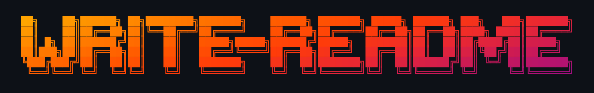

<p align="center">
  
</p>

# write-readme: a README generator skill for Claude Code

<p align="center">
  <a href="#install">
    
  </a>
</p>

[](LICENSE) [](https://skills.sh/ephemerallycaden/write-readme/write-readme)

write-readme is a README generator for Claude Code, packaged as an agent skill. Run `/readme` in a project and it reads the codebase, detects which of 20 project types it is, and writes the project README.md. Install and run commands come first, checked against your build files. Screenshots come from the repo or are captured with Playwright or VHS. Every sentence is held to a set of anti-AI writing rules before you see the draft, so the README doesn't read as AI-generated slop.

> This README was generated by write-readme.

## Install

```bash
npx skills add ephemerallyCaden/write-readme -g -y
```

## Usage

```
/readme                  # standard
/readme minimal          # 30-80 lines, essentials only
/readme detailed         # every section the project type supports
/readme --type cli       # override the detected project type
/readme critique         # review an existing README, then apply the fixes you pick
/readme architecture     # write an ARCHITECTURE.md for contributors
```

It asks at most three questions, shows you the full draft, and writes `README.md`, and any screenshots it captured, only after you approve. If a README already exists, it can enhance it and keep the sections you wrote by hand.

## What it prioritises

### How to run comes first

The install and run commands sit directly under the title and hero image, ahead of features and architecture. Commands are checked against your build files, so you won't get `npm start` without a start script, `java -jar` without a shaded jar, or `dart run` on a Flutter app.

### It looks the part

It searches the whole project tree for images, including screenshots, test renders and design folders, then looks at each one. If a visual project has no screenshots yet, it offers to capture them (Playwright for web apps, VHS for terminals) or leaves a placeholder that says exactly what to capture.

### It sounds like a person wrote it

The writing rules are adapted from several avoid-AI-writing skills and applied while the draft is written, then checked again before you see it. They ban a list of words, section intros that explain what the section covers, and bold-label feature bullets. Every sentence also has to pass a portability test: if it could appear unchanged in another project's README, it gets rewritten with a fact about yours.

## Example

<p align="center">
  
  &nbsp;&nbsp;
  
  &nbsp;&nbsp;
  
</p>

[Generated README for Ganba](examples/ganba-mobile-app.md), a Flutter climbing tracker. write-readme detected it as a Mobile App, found 30 golden test renders in the repo, and used three of them for the screenshots in this section.

## Code of Conduct

This project follows the [Contributor Covenant 2.1](CODE_OF_CONDUCT.md).

## License

MIT
