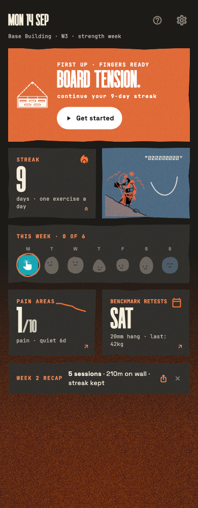
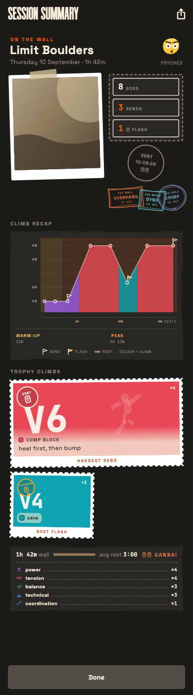
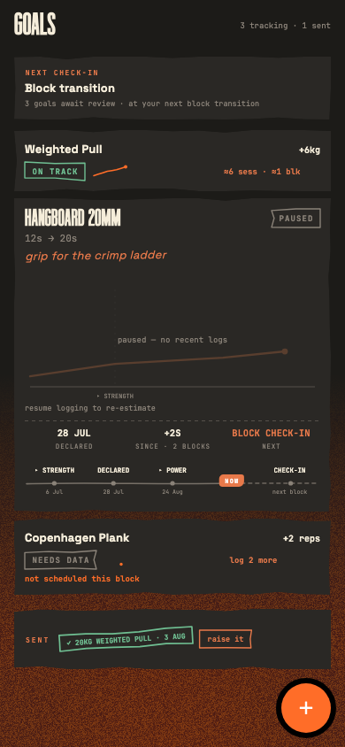
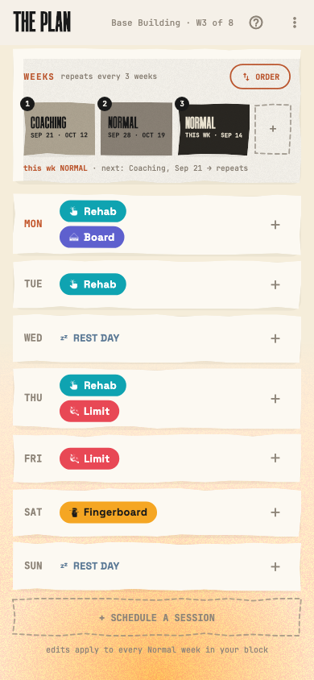
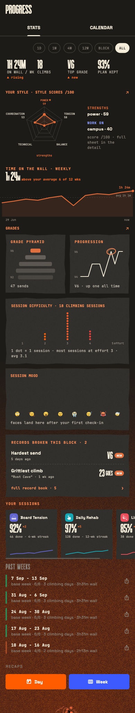
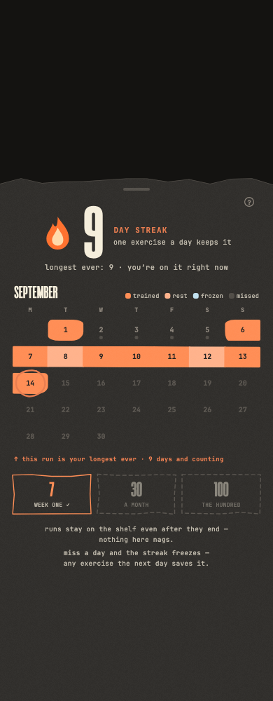
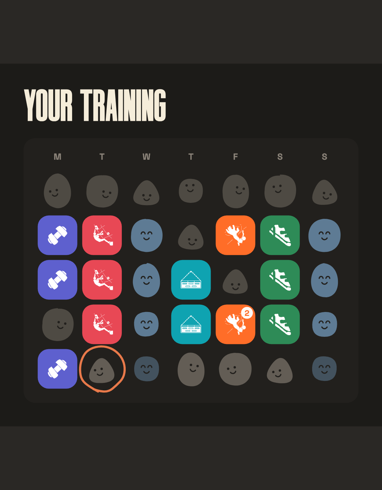
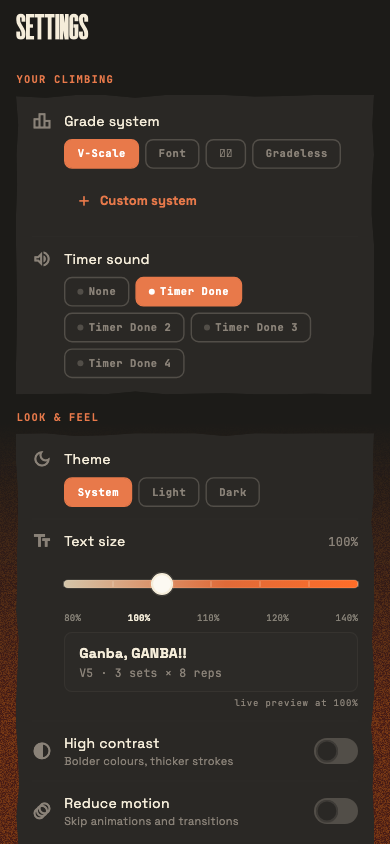
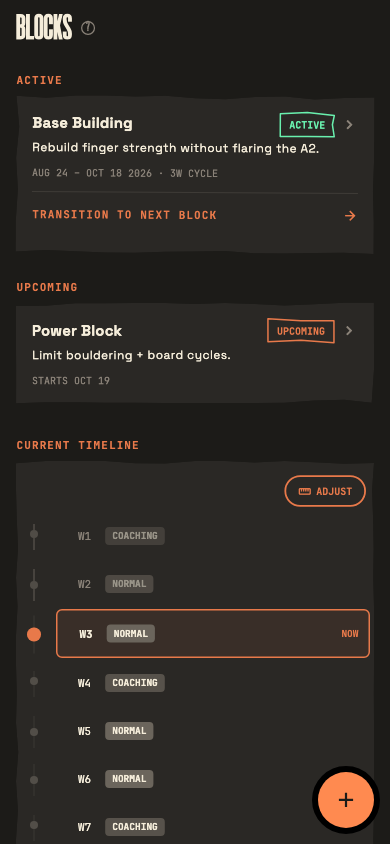

<!-- write-readme session transcript

  Detected: Mobile App (Flutter, pubspec.yaml + android/ + ios/)
  Solo project: yes (1 contributor, 0 stars)
  Existing screenshots: yes — ganba-screens/ contains 30 golden test renders

  > The app display name is "Ganba!" but the package name is
  > "projecting_not_sending". Which should the README use as the title?
  Ganba!

  > Describe your project in 1-2 sentences.
  Personal climbing training tracker with periodized phases, rehab tracking, and benchmarks.

  Options:
    License:       [Skip]
    Contributing:  [Skip — solo project]
    Verbosity:     [Standard]
    Screenshots:   [Use existing — ganba-screens/ has rendered screens]

-->

# Ganba!


A personal climbing training tracker for periodized training, rehab, and benchmarks. Offline-first — all data stored locally in SQLite, no account or network required.

<p align="center">
  
  &nbsp;&nbsp;
  
  &nbsp;&nbsp;
  
</p>

## Getting Started

Requires [Flutter SDK](https://docs.flutter.dev/get-started/install) 3.12+, Android Studio or Xcode, and a device or emulator.

```bash
git clone https://github.com/ephemerallyCaden/Ganba.git
cd Ganba
flutter pub get
flutter run
```

## Features

- **Training Phases** -- Periodized blocks with auto-advancing phases and deload weeks
- **Session Logging** -- Log climbs with grade, outcome, style, and media attachments
- **Session Summary** -- Post-session breakdown with climb recap charts, trophy climbs, and style distribution
- **Drill Timer** -- Foreground-service timer with work/rest intervals and sound cues
- **Progress Stats** -- Charts for grades, sessions, volume, and personal records
- **Pain Monitoring** -- Track injury areas with severity ratings and alert thresholds
- **Goal Setting** -- Goals tied to specific exercises with automatic progress tracking
- **Benchmarking** -- Record and retest performance benchmarks on a schedule
- **Training Plan** -- Visual canvas for scheduling sessions into weekly templates
- **Year in Review** -- Five-slide carousel summarizing your training year
- **Achievements** -- Unlockable achievements on a collectible wall

<details>
<summary>More screenshots</summary>

<p align="center">
  
  &nbsp;&nbsp;
  
  &nbsp;&nbsp;
  
</p>

<p align="center">
  
  &nbsp;&nbsp;
  
  &nbsp;&nbsp;
  
</p>

</details>

## Tech Stack

| Layer | Technology |
|---|---|
| Framework | Flutter (Dart 3.12+) |
| State | Riverpod |
| Database | sqflite (SQLite) |
| Charts | fl_chart |
| Notifications | flutter_local_notifications |
| Media | image_picker, video_player |

## Status

Early alpha (`0.1.0-alpha.1`). Under active development. Not yet on app stores.

## License

All rights reserved.
