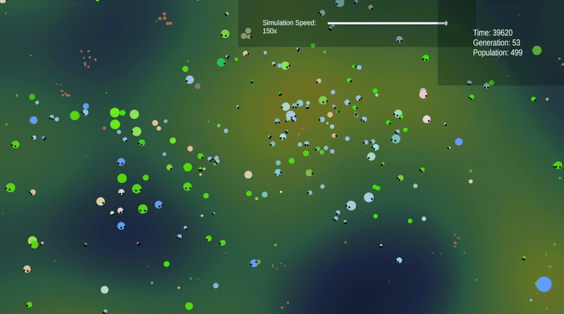
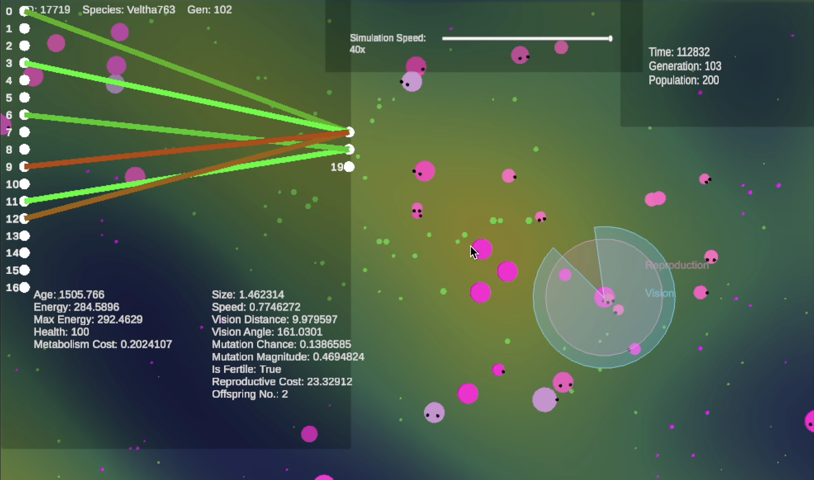
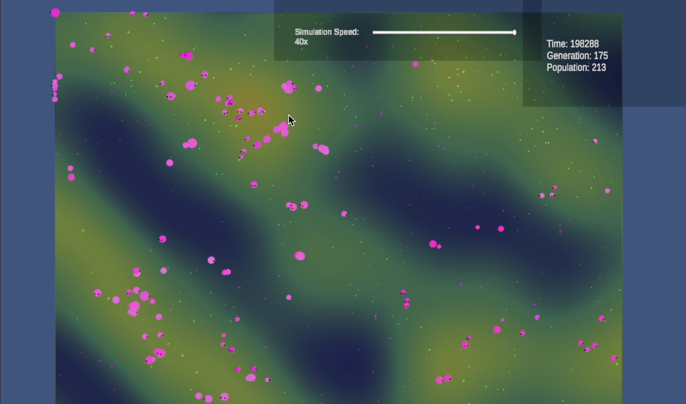

<!-- TinySim README, after: write-readme skill

  Generated 2026-10-28 by the write-readme skill (/readme) in Claude Code,
  run on a clone of github.com/ephemerallyCaden/TinySim at 84586bb:
  7cafb75 plus one local commit that adds media/ (the three files in
  ./media) and removes the original 2-line README. The two PNGs here are
  downscaled from 3456 to 1728 px wide; nothing else changed. The GIF is
  the original file.

  Everything below this comment is the unedited output. Line numbers
  quoted in assets/readme-before-after.png count from the line after it.
-->
# TinySim



TinySim is a neuroevolutionary ecosystem simulator built with the NEAT algorithm in the Unity game engine (C#). Each agent on a 2D, temperature-mapped world carries its own NEAT genome, and new generations come from agents finding a mate, so survival does the selecting instead of a fitness score.

## Getting Started

Requires Unity 6000.0.74f1.

```bash
git clone https://github.com/ephemerallyCaden/TinySim.git
```

1. In Unity Hub, click **Add**, then pick the cloned `TinySim` folder. `Library/` is gitignored, so Unity imports every asset the first time it opens the project.
2. Open `Assets/Scenes/WorldCreation.unity`.
3. Press Play.

The World Creation screen opens with a temperature map preview next to the world settings: seed (the dice button picks a random one), world size, temperature scale and cold skew, starting and maximum population, spawn pattern (Central, Clusters, or Random), starting and maximum food, predation, and the starting range for each agent attribute. Tick "Uniform Species?" to start every agent with the same attributes instead. Click **Generate Simulation** to load `Assets/Scenes/Main.unity` and start the run.

## Features

- Temperature map: Perlin noise sets a temperature for every tile. Plant food spawns with a 90% chance in the warmest areas and 10% in the coldest, and cold tiles can grow poison instead.
- Vision cone sensing: each brain gets 22 inputs, among them health, age, hunger, local temperature, and the distance and angle to the closest agent, plant, meat, and poison it can see, plus a recurrent "desire" value.
- Brains drive movement, turning, and desire, plus an attack output when predation is on.
- NEAT mutations: weight perturbation, new connections, new nodes that split a connection, disabled connections, pruned hidden nodes, and activation function swaps between sigmoid, tanh, ReLU, leaky ReLU, and linear.
- Traits evolve alongside the network: size, speed, vision distance and angle, reproduction cooldown and energy cost, diet preference, attack damage, and each agent's own mutation chance and magnitude.
- Diet runs from 0 (plants only) to 1 (meat only). Dead agents drop meat, and with predation enabled agents can attack each other.
- Speciation uses the NEAT compatibility distance from Stanley and Miikkulainen (2002) plus a term for differences in physical traits. Each species gets a generated name, child species keep their ancestor's prefix, and a species whose genome drifts far enough from its founder is renamed as a successor species.

## Controls

| Input | Action |
|-------|--------|
| WASD or arrow keys | Pan the camera |
| Right or middle mouse drag | Pan the camera |
| Mouse wheel, `+` / `-` | Zoom |
| Left click on an agent | Show its stats and neural network; click empty space to close |
| Simulation speed slider | Set speed from 0x to 150x |
| `]` / `[` | Speed up or slow down by 1x (between 1x and 20x) |
| `P` | Pause or resume |
| `Tab` | Open or close the analytics panel |
| `1`, `2`, `3` | Switch the analytics panel between Overview, Attributes, and Species |



Selecting an agent draws its vision cone and its eating, reproduction, and attack ranges on the map. The panel lists its ID, species, generation, age, energy, health, metabolism cost, traits, diet, fertility, reproduction cooldown, and offspring count.

The analytics panel holds:

- Overview: current and peak population, births, deaths, and average lifetime, average and peak generation, active, created, and extinct species, population-average traits, and how much plant, meat, and poison has been eaten.
- Attributes: population-average trait values over time.
- Species: a phylogenetic tree of every species. Scroll it to look back through history, and click a species to see its stats, a preview of its average body, its neural network, and its chain of ancestors.



## Configuration

Every simulation parameter lives in `Assets/SimulationConfig.asset`, which both scenes share. The World Creation screen writes its settings into that asset, and the Inspector exposes the rest: metabolism costs, aging, reproduction costs, mutation thresholds, attribute limits, food nutrition and despawn times, poison strength, and speciation coefficients. In the Editor, values changed while in Play mode stay in the asset after you stop.

Defaults in the committed asset:

| Setting | Value |
|---------|-------|
| `worldSize` | 200 |
| `seed` | -1 (random each run) |
| `initialAgentCount` / `maxPopulation` | 500 / 500 |
| `spawnPattern` | 2 (Random) |
| `initialFoodCount` / `maxFoodCount` | 1275 / 5000 |
| `enablePredation` | on |

To make a second config, use **Assets > Create > TinySim > Simulation Config** and assign it to `SimulationManager` in `Main.unity` and `WorldCreationUI` in `WorldCreation.unity`.

## Project Structure

| Path | Contents |
|------|----------|
| `Assets/Scripts/NeuralNetworks/` | Genome, network, activation functions, input and output labels |
| `Assets/Scripts/Evolution/` | Mutation, crossover, innovation numbers, speciation, species history |
| `Assets/Scripts/Agents/` | Agent behaviour, spawning, instanced rendering |
| `Assets/Scripts/Environment/Food/` | Plant, meat, and poison food and the food spawner |
| `Assets/Scripts/Generation/` | Terrain and temperature map generation |
| `Assets/Scripts/UI/` | Stats panels, graphs, phylogenetic tree, World Creation screen |
| `Assets/Scripts/Core/` | Simulation loop, config, seeded random numbers, events |

[OPTIMISATIONS.md](OPTIMISATIONS.md) records the changes made to raise the agent count past about 300: allocation-free network evaluation, pre-allocated instanced rendering, cached component lookups for vision, and reused dictionaries in speciation.

## License

The repository does not include a license file.
